# Parte 2 · Análise antes × depois (CSR × SSR)

**Página analisada:** Pacote Pantanal — Horizonte Verde Turismo  
(`/csr/pacotes/pantanal` e `/ssr/pacotes/pantanal`)

**Versões:** CSR e SSR

**Framework ou JavaScript puro:** JavaScript puro (Express + vanilla JS, sem React/Vue/etc.)

> Medições feitas no build de produção, nas mesmas condições, nas duas versões  
> (cache de rede desabilitado, sem throttling de CPU/rede).

---

## 1. HTML inicial

**Onde ver:** view-source: — o conteúdo está no HTML?

**CSR:**

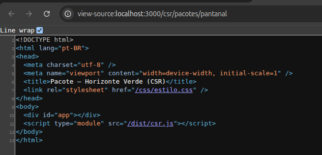

**SSR:**

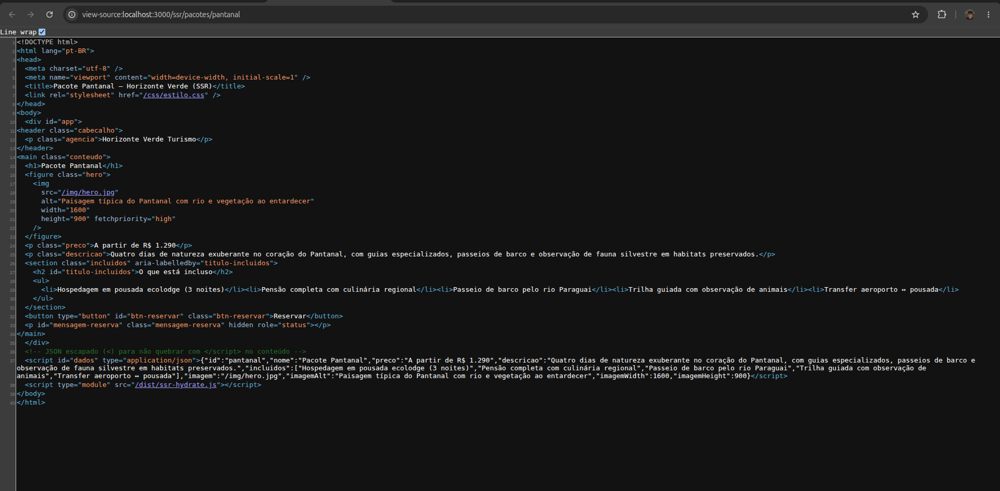

**Comparação:** No CSR, o `view-source` mostra só um casco: `#app` vazio e o script `/dist/csr.js`. Título genérico, sem texto do pacote, preço ou imagem. No SSR, o HTML já traz nome, preço, descrição, lista do que está incluso, `hero.jpg` com `fetchpriority="high"` e JSON embutido para hydration. Conclusão: bots e prévias de compartilhamento veem conteúdo real só na versão SSR; no CSR dependem do JavaScript.

---

## 2. Waterfall

**Onde ver:** Network — quando o documento e a imagem LCP começam.

**CSR:**

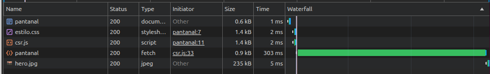

**SSR:**

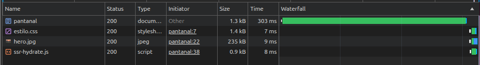

**Comparação:** No CSR o documento chega rápido (~1 ms, ~0,6 kB), mas a cadeia é: HTML → CSS/JS → `fetch` da API (~303 ms) → só então `hero.jpg`. A imagem LCP só começa depois do JavaScript e da API. No SSR o documento demora ~303 ms (TTFB com o mesmo atraso de dados no servidor), mas já traz a URL da imagem: `hero.jpg` inicia junto com CSS e o script de hydrate, sem round-trip extra no cliente. Conclusão: o atraso de 300 ms existe nas duas versões; no CSR ele bloqueia o início da imagem LCP no navegador; no SSR ele fica no TTFB e a imagem é descoberta no primeiro HTML.

---

## 3. JavaScript

**Onde ver:** Network (filtro JS) — quantidade e tamanho.

**CSR:**

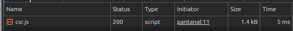

**SSR:**

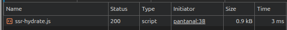

**Comparação:** Ambas carregam **1** arquivo JS. CSR: `csr.js` (~1,4 kB) — busca a API, monta o DOM e liga o botão. SSR: `ssr-hydrate.js` (~0,9 kB) — só lê o JSON embutido e liga o botão, sem recriar a página. Conclusão: o SSR envia menos JS e esse JS não é necessário para *ver* o conteúdo; no CSR o JS é obrigatório para qualquer conteúdo útil aparecer.

---

## 4. LCP

**Onde ver:** Performance (métricas ao vivo) e Lighthouse.

**CSR:**

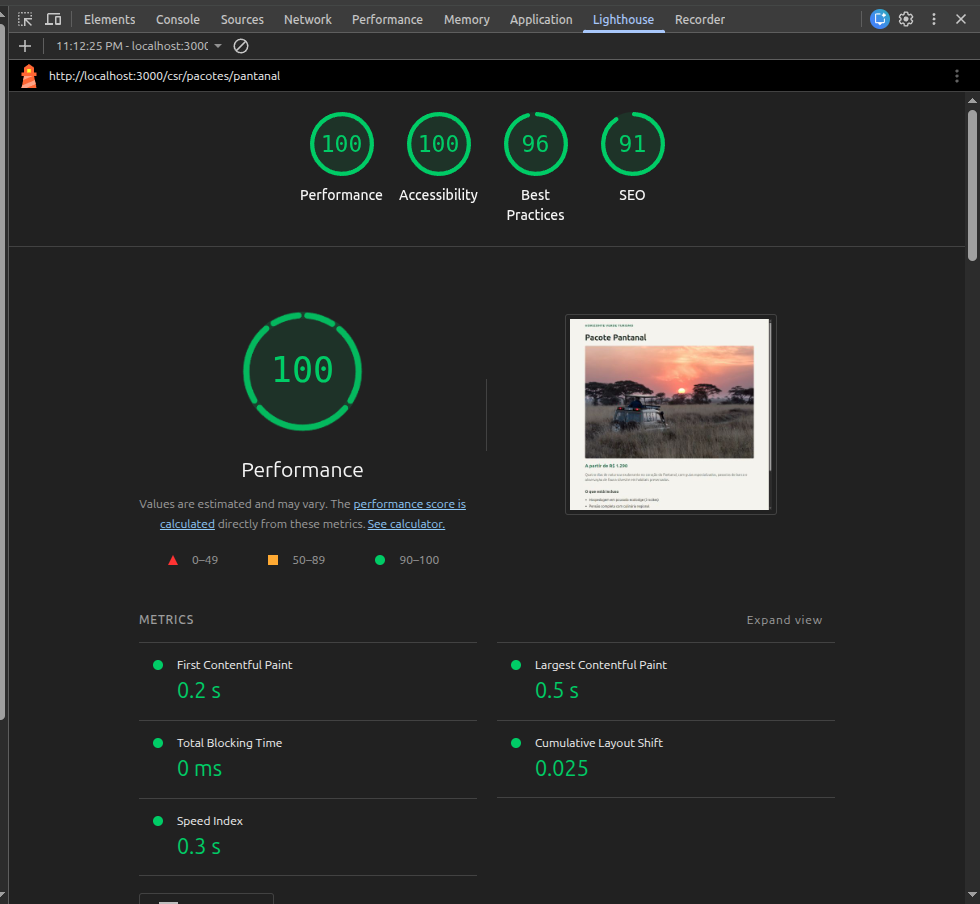

**SSR:**

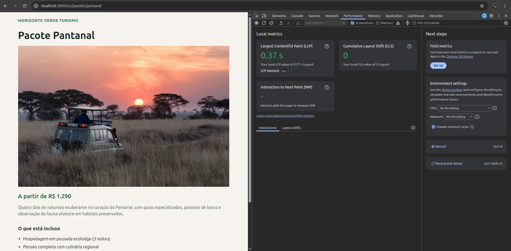

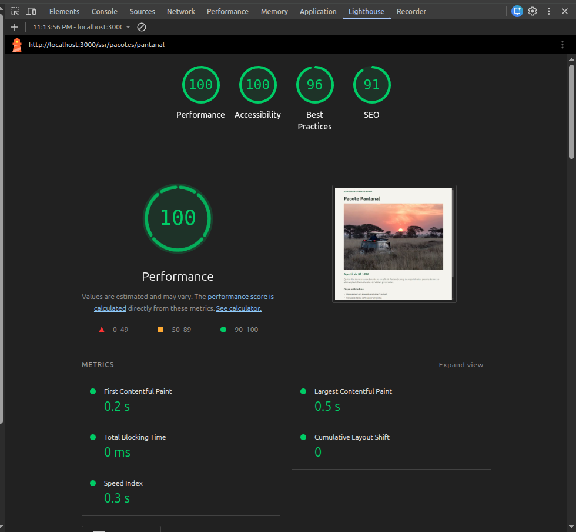

**Comparação:** Nas métricas ao vivo, LCP ficou quase igual: CSR **0,36 s** e SSR **0,37 s** (elemento LCP = `img` do hero). No Lighthouse, as duas versões tiveram Performance **100** e LCP **0,5 s**. Isso não contradiz o waterfall: o atraso artificial de 300 ms está no cliente (CSR) ou no servidor (SSR), então o instante em que a imagem grande pinta fica parecido em localhost. O ganho do SSR aparece em SEO/HTML inicial e na ordem de descoberta dos recursos; o LCP numérico só divergiria de forma clara se o HTML SSR viesse de CDN/cache (TTFB baixo) enquanto o CSR ainda esperasse JS + fetch.

---

## 5. Hydration

**Onde ver:** Console — avisos e erros de hydration.

**CSR:**

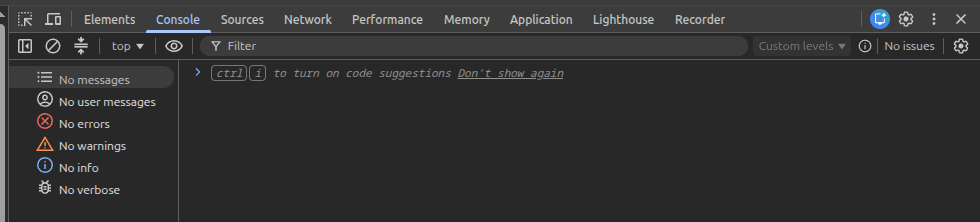

**SSR:**

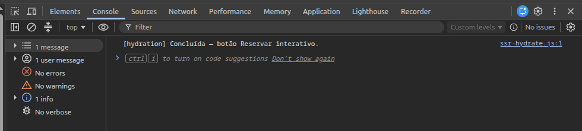

**Comparação:** No CSR o console está limpo e **não há hydration** — a página é montada do zero no cliente (`innerHTML` após o fetch). No SSR aparece `[hydration] Concluída — botão Reservar interativo.`, sem avisos nem erros: o HTML do servidor é reaproveitado e o JS só torna o botão interativo. Conclusão: hydration é um passo exclusivo do SSR neste demo; o importante é que ela não quebrou o DOM nem gerou mismatch.

---

## Síntese

| Critério | CSR | SSR |
|---|---|---|
| Conteúdo no HTML inicial | Não | Sim |
| Imagem LCP descoberta | Depois de JS + API | No primeiro HTML |
| JS necessário para ver conteúdo | Sim (~1,4 kB) | Não (~0,9 kB só para interação) |
| LCP medido (localhost) | ~0,36–0,5 s | ~0,37–0,5 s (similar pelo atraso compartilhado de 300 ms) |
| Hydration | Não se aplica | OK, sem erros |

Em resumo: as duas versões pintam o hero em tempos parecidos neste ambiente controlado, mas o SSR entrega HTML completo mais cedo na resposta HTTP, melhora SEO/compartilhamento e reduz o trabalho do cliente; o CSR deixa o conteúdo e a imagem LCP dependentes do JavaScript e do fetch.
