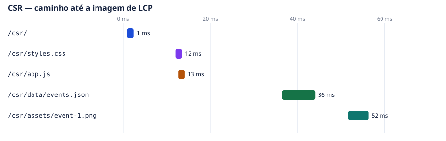
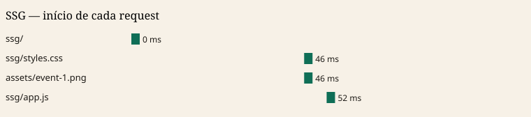

# Parte 2 — A mesma página em CSR e em SSG

O catálogo da aula, com os mesmos 12 eventos e as mesmas imagens de `assets/`. CSR é o HTML casca: `app.js` busca `data/events.json` e cria os cards. SSG é o HTML gerado por `node aula-03/scripts/build.mjs`: os cards já estão no arquivo, e o script só liga filtro, ordenação e o detalhe.

Com o script ligado, as duas telas fazem a mesma coisa. Sábado devolve «4 eventos encontrados». Esporte na sexta devolve «0 eventos encontrados». **Ver detalhes** abre o Festival de Música no Parque.

## Protocolo

Medição em 6 de novembro de 2026, 22:32 (horário de Brasília). Chrome headless 156, viewport 1280×800.

- Servidor estático do Python na raiz do repositório, `http://127.0.0.1:4727`. Sem gzip.
- Cache desligado. Latência emulada de 40 ms e vazão de 1,28 MB/s, cerca de 10 Mbps.
- Três cargas de cada URL. A mediana é a carga do meio no LCP.
- URLs: `http://127.0.0.1:4727/aula-03/dist/csr/` e `http://127.0.0.1:4727/aula-03/dist/ssg/`.

A imagem em jogo é `assets/event-1.png`, 646.752 bytes. No viewport de 1280 px a primeira fileira mostra três cards, então o Chrome registrou o LCP em `event-2.png`, que pesa o mesmo tanto. O que muda entre as estratégias é o instante em que essa fileira começa a ser pedida.

## Comparação

| O que comparar | CSR | SSG |
| --- | --- | --- |
| HTML inicial | Casca. Não há título de evento nem `event-1.png`. 1.988 bytes no disco, 2.175 transferidos. | Os 12 cards já estão no documento. A primeira imagem tem `fetchpriority="high"`. 11.256 bytes no disco, 11.444 transferidos. |
| Waterfall | Documento, e aos 46 ms o CSS junto com `app.js`. `events.json` aos 96 ms. `event-1.png` aos 142 ms. | Documento, e aos 46 ms o CSS junto com `event-1.png`. `app.js` aos 52 ms. Não existe request de JSON. |
| JavaScript | 1 arquivo, `app.js`, 3.807 bytes no disco e 4.000 transferidos. Mais o JSON, 2.900 bytes no disco e 3.094 transferidos. O script cria o catálogo. | 1 arquivo, `app.js`, 2.021 bytes no disco e 2.214 transferidos. O script não busca dado e não recria a lista. |
| LCP | 3.236, 3.248 e 3.268 ms. Mediana **3.248 ms**, em `event-2.png`. | 3.192, 3.192 e 3.204 ms. Mediana **3.192 ms**, também em `event-2.png`. |
| Hydration | Não há. O conteúdo não está no HTML; o script cria os cards. Sem o script, a grade tem 0 cards. | Não há. O HTML já é o conteúdo. Sem o script, a grade tem 12 cards. O console não acusou mismatch. |

A diferença de LCP na mediana é 56 ms. É o mesmo atraso com que o CSR dispara a imagem da primeira fileira: `event-2.png` começa aos 162 ms no CSR e aos 103 ms no SSG. O download de cerca de 650 KB, na vazão de 1,28 MB/s, domina o número. A estratégia aparece antes, no tempo até o navegador saber o `src`.

## HTML inicial

No CSR, a resposta descreve a página como conteúdo montado no navegador. A grade não traz evento. Sem executar `app.js`, o texto fica em «Carregando eventos...» e `querySelectorAll(".card")` devolve 0.

No SSG, a meta description já diz que o HTML traz os 12 eventos, e o primeiro `<article>` tem a imagem, o título e o texto do Festival de Música no Parque. Sem executar `app.js`, os 12 cards continuam no documento.

## Waterfall

Escala da rodada mediana. O número é o início do request, contado a partir do documento.

No CSR a imagem espera o JavaScript executar e o `events.json` voltar. No SSG o parser encontra o `src` no HTML e dispara a imagem junto com o CSS, em paralelo com o script.

## JavaScript

| Arquivo | CSR | SSG |
| --- | --- | --- |
| Documento HTML | 1.988 bytes (2.175 transferidos) | 11.256 bytes (11.444 transferidos) |
| `app.js` | 3.807 bytes (4.000 transferidos) | 2.021 bytes (2.214 transferidos) |
| `data/events.json` | 2.900 bytes (3.094 transferidos) | não existe |
| `styles.css` | 3.266 bytes (3.452 transferidos) | 3.266 bytes (3.452 transferidos) |
| `assets/event-1.png` | 646.752 bytes (646.941 transferidos) | 646.752 bytes (646.941 transferidos) |

## Hydration

Não existe virtual DOM, então não existe hydration e o console não emite aviso de mismatch. As três rodadas de cada URL fecharam sem exceção.

O que dá para observar no lugar:

- No CSR, sem o `<script>`, a grade fica vazia. O conteúdo só nasce quando `app.js` busca o JSON e cria os cards.
- No SSG, sem o `<script>`, a lista e a imagem ficam no lugar. No carregamento o script não reescreve o HTML; ele escuta o filtro, a ordenação e o botão de detalhe.

Os números das três rodadas estão em [evidencias/resumo.json](evidencias/resumo.json).
