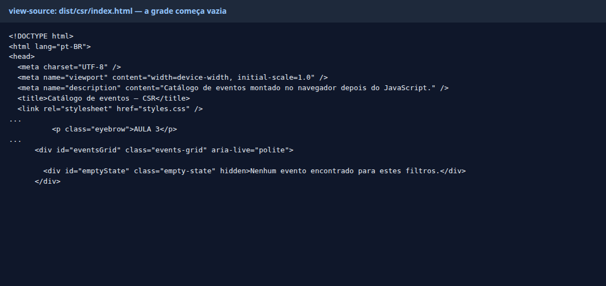
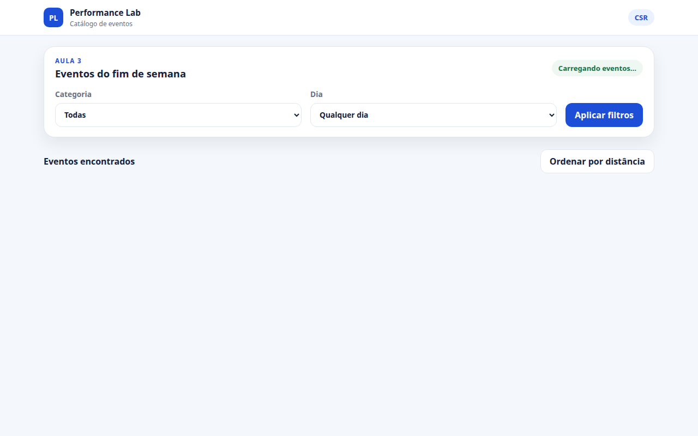
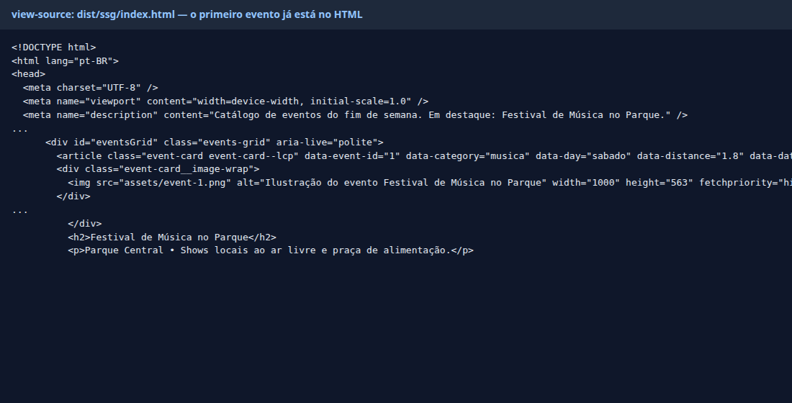
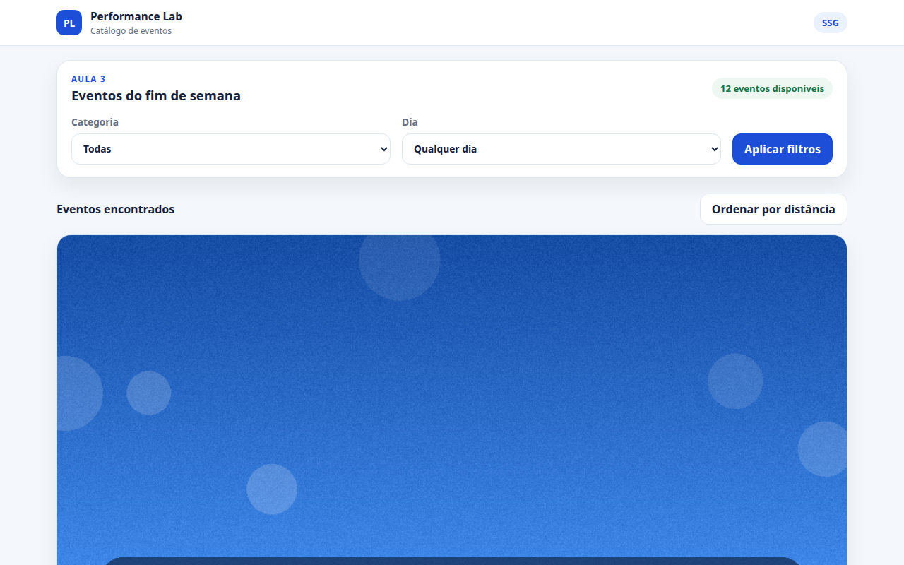
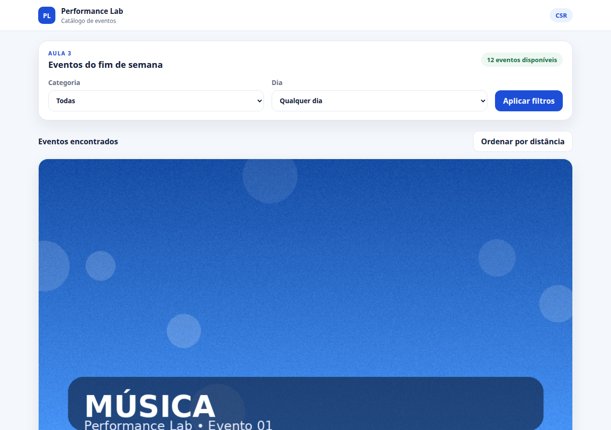
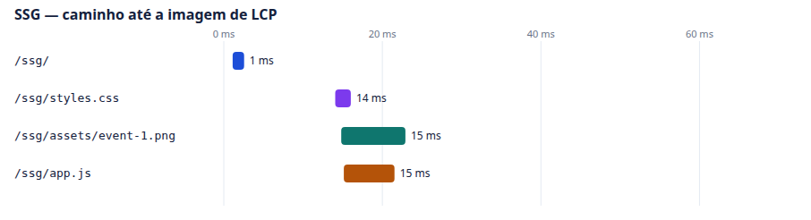
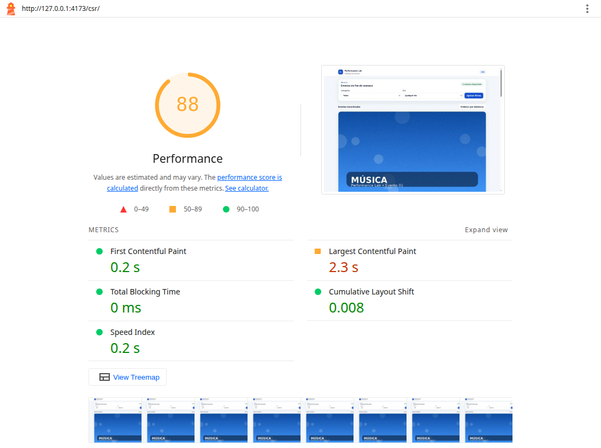

# Parte 2 — Análise antes × depois

A mesma página do catálogo, em duas versões. CSR é o antes: o HTML chega vazio e o conteúdo só aparece depois do JavaScript. SSG é o depois: o HTML já sai do build com o conteúdo. O visual, com o script ligado, é o mesmo.

O build de produção é a pasta `dist/`, gerada por `node scripts/build.mjs`. Não há bundler, minify, source map nem live reload. As duas versões usam o mesmo CSS, as mesmas imagens e o mesmo servidor estático.

## Protocolo

Medição em 6 de novembro de 2026, na mesma máquina, com Node 22 e Chrome headless.

- Servidor estático em `http://127.0.0.1:4173`, só com a pasta `dist/`.
- `Cache-Control: no-store`. Sem gzip. Lighthouse abre um perfil limpo a cada rodada.
- Lighthouse no preset **desktop**: RTT 40 ms, vazão 10.240 kbps, CPU 1×.
- Três rodadas de cada URL. A mediana é a rodada do meio do LCP observado.
- URLs: `http://127.0.0.1:4173/csr/` e `http://127.0.0.1:4173/ssg/`.

O elemento de LCP das duas versões é a mesma imagem, `assets/event-1.png`, com 1000×563 e 646.752 bytes. No viewport do Lighthouse ela ocupa cerca de 1118×629.

## Comparação

| O que comparar | CSR | SSG |
| --- | --- | --- |
| HTML inicial | Casca. `#eventsGrid` só tem o estado vazio. Não há título de evento nem `event-1.png`. 3.420 bytes. | Os 12 cards já estão no documento. A primeira imagem tem `fetchpriority="high"`. 13.906 bytes. |
| Waterfall | Documento, CSS e `app.js` por volta de 12 ms. `events.json` começa aos 36 ms. A imagem de LCP começa aos 52 ms. | Documento, e em seguida CSS, imagem e `app.js` juntos, por volta de 15 ms. Não existe request de JSON. |
| JavaScript | 1 arquivo, `app.js`, 4.955 bytes no disco e 5.170 transferidos. Mais o JSON, 2.938 bytes no disco e 3.138 transferidos. O script monta o catálogo. | 1 arquivo, `app.js`, 2.931 bytes no disco e 3.145 transferidos. O script só liga filtro, ordenação e o dialog. |
| LCP | Observado: 176, 141 e 138 ms. Mediana **141 ms**. Simulado: **2,3 s**, nota 88 nas três rodadas. Load delay da imagem: **733 ms** (32% do LCP). | Observado: 108, 101 e 178 ms. Mediana **108 ms**. Simulado: **2,3 s**, notas 88, 89 e 88. Load delay da imagem: **209 ms** (9% do LCP). |
| Hydration | Não há hydration. O conteúdo não existe no HTML; o script cria os cards. O console não tem aviso de mismatch. | Não há hydration. O HTML já é o conteúdo. O script não reescreve a lista no carregamento. O console também fica limpo. |

## HTML inicial

No CSR, o `view-source` descreve a página como conteúdo montado no navegador. A grade não traz evento:

Sem executar `app.js`, a tela fica na casca, com o texto "Carregando eventos...":

No SSG, a meta description já cita o Festival de Música no Parque, e o primeiro `<article>` traz a imagem, o título e o texto:

Sem executar `app.js`, a imagem e a lista aparecem do mesmo jeito:

Com o script, as duas telas ficam iguais, fora o selo CSR ou SSG:

Filtro, ordenação e o dialog de detalhe funcionam nas duas. Sábado devolve quatro eventos: Festival de Música no Parque, Feira Gastronômica Regional, Oficina Infantil de Ciência e Aulão Funcional. Esporte na sexta devolve "0 eventos encontrados".

## Waterfall

Escala única de 0 a 70 ms, na rodada mediana. O número ao lado da barra é o início do request. Os outros PNGs do catálogo ficaram de fora deste recorte: eles começam depois e não mudam a descoberta da imagem de LCP.

No CSR a imagem espera o JavaScript executar e o `events.json` voltar. No SSG o parser encontra o `src` no HTML e dispara a imagem junto com o CSS, em paralelo com o script.

O navegador também pede `/favicon.ico` e recebe 404 nas duas versões. Esse request não entra no recorte.

## JavaScript

| Arquivo | CSR | SSG |
| --- | --- | --- |
| Documento HTML | 3.420 bytes (3.628 transferidos) | 13.906 bytes (14.115 transferidos) |
| `app.js` | 4.955 bytes (5.170 transferidos) | 2.931 bytes (3.145 transferidos) |
| `data/events.json` | 2.938 bytes (3.138 transferidos) | não existe |
| `styles.css` | 5.141 bytes | 5.141 bytes |
| `assets/event-1.png` | 646.752 bytes | 646.752 bytes |

O filtro JS do Network mostra um script em cada versão. O CSR acrescenta o fetch do JSON. O SSG lê título, data e descrição dos atributos que já estão no card.

## LCP

As duas notas simuladas empatam em 88, com LCP de 2,3 s, porque a imagem é a mesma e pesa 632 KiB. No preset desktop, o tempo de render dessa imagem domina o número final: cerca de 1,4 s no CSR e 1,8 s no SSG. A estratégia aparece na fase anterior, o load delay — o tempo entre a resposta do documento e o início do download da imagem.

| Fase do LCP simulado | CSR | SSG |
| --- | --- | --- |
| TTFB | 122 ms (5%) | 123 ms (5%) |
| Load delay | 733 ms (32%) | 209 ms (9%) |
| Load time | 77 ms (3%) | 171 ms (7%) |
| Render delay | 1.372 ms (60%) | 1.784 ms (78%) |

No localhost, sem a throttling do Lighthouse, o LCP observado acompanha o waterfall: 141 ms no CSR e 108 ms no SSG. O FCP observado do CSR é 68 ms, a casca, e o LCP vem depois, com a imagem. No SSG os dois caem no mesmo instante, 108 ms.

CLS da rodada mediana: 0,008 no CSR e 0 no SSG. TBT: 0 ms nos dois.

Os relatórios completos estão em [evidencias/csr-lighthouse.html](evidencias/csr-lighthouse.html) e [evidencias/ssg-lighthouse.html](evidencias/ssg-lighthouse.html). As três rodadas em JSON estão em `evidencias/csr-1.report.json` até `csr-3` e `ssg-1` até `ssg-3`. O recorte numérico está em [evidencias/resumo.json](evidencias/resumo.json).

## Hydration

Esta comparação é JavaScript puro. Não existe virtual DOM, então não existe hydration e o console não emite aviso de mismatch. A auditoria `errors-in-console` do Lighthouse veio vazia nas rodadas medianas.

O que dá para observar, no lugar do hydration:

- No CSR, apagar o `<script>` deixa a grade vazia. O conteúdo só nasce quando `app.js` busca o JSON e escreve os cards.
- No SSG, apagar o `<script>` deixa a lista e a imagem no lugar. O script não reconstrói o HTML no carregamento; ele escuta o filtro, a ordenação e o botão de detalhe.

Isso é o equivalente, em página estática, da diferença que um framework mostraria entre uma árvore criada no cliente e uma árvore que o servidor já entregou pronta.
